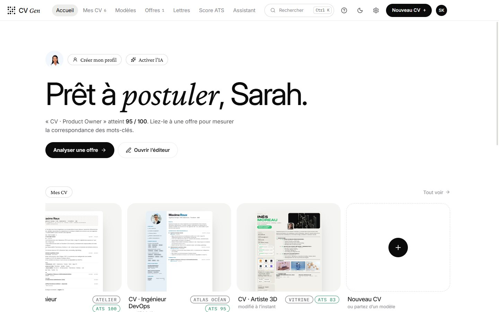
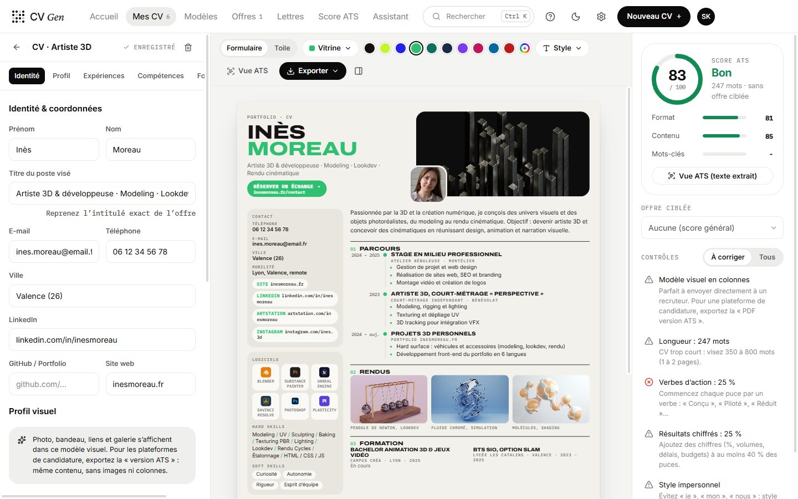
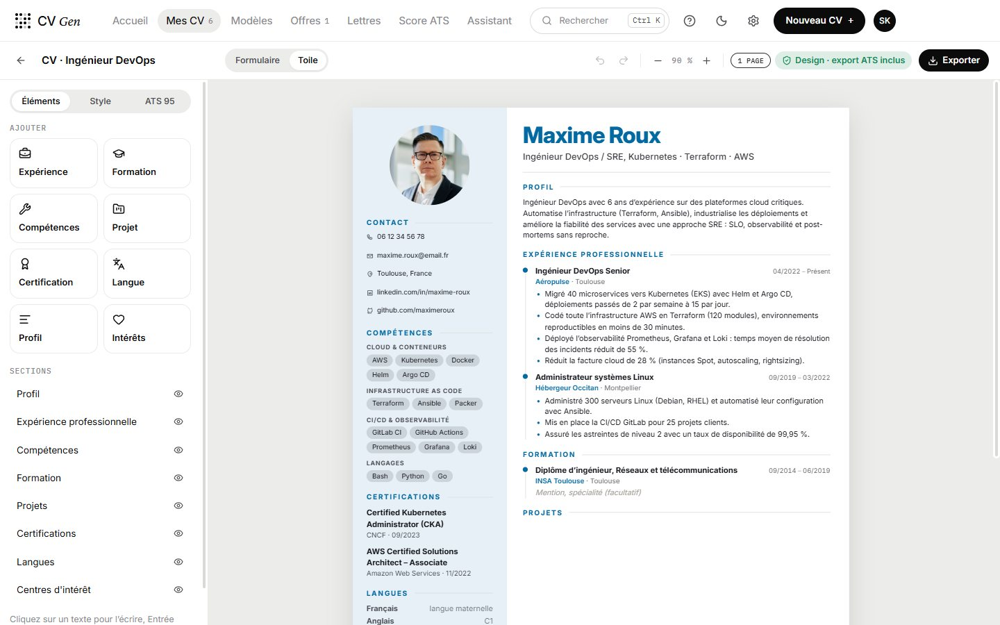
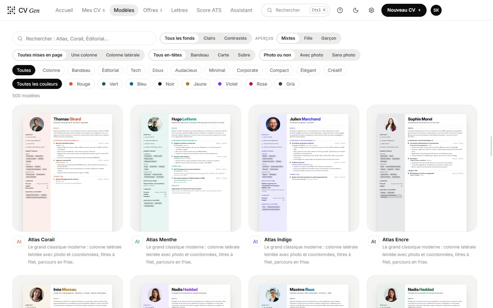
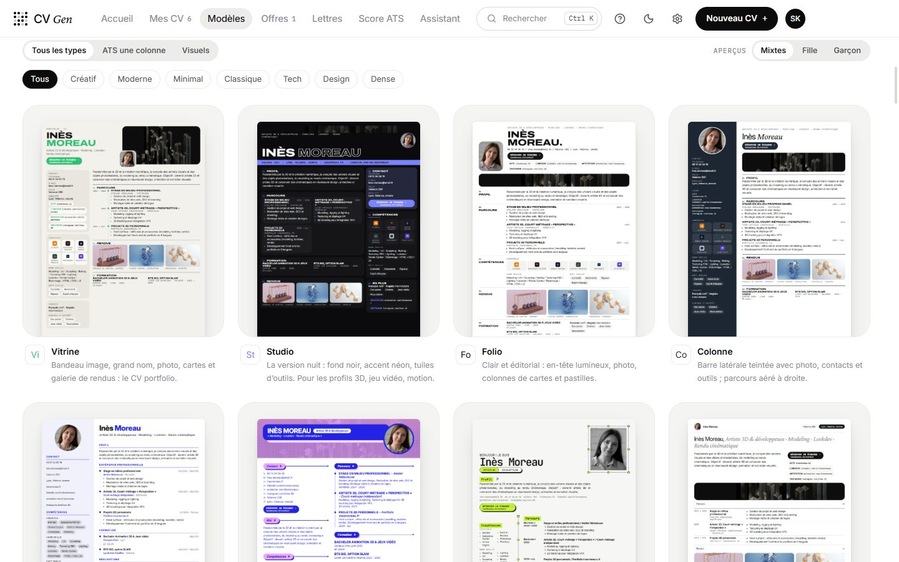
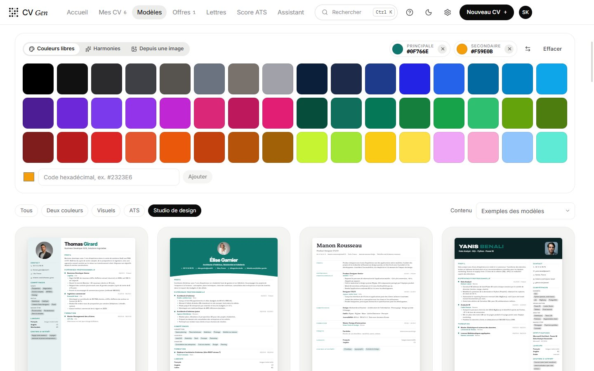
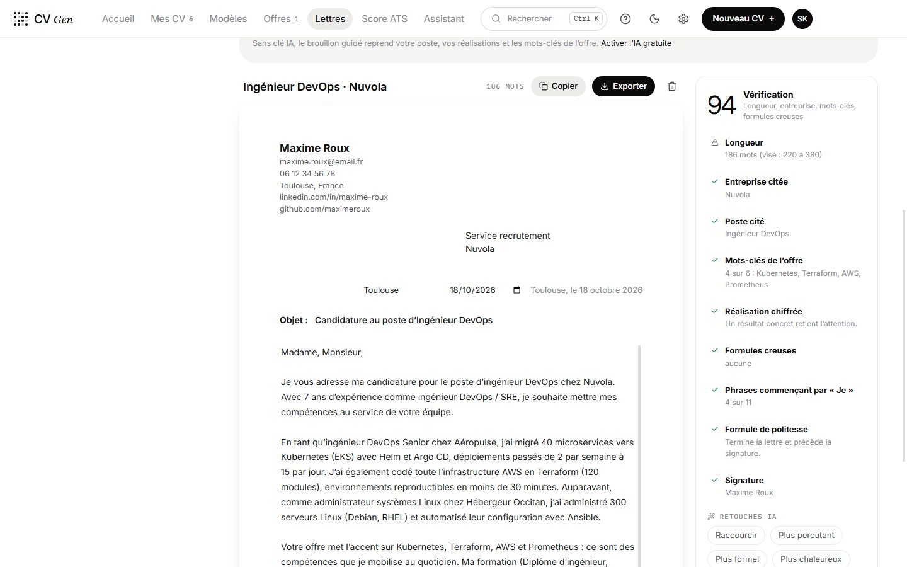
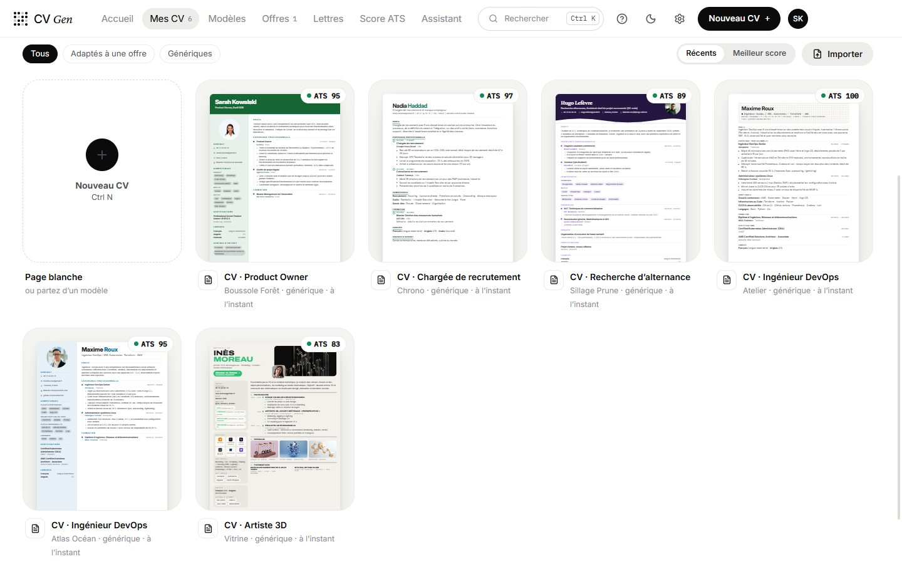

**English** · [Français](README.fr.md)

# CV GEN

A Windows app to build ATS-friendly resumes and tailor them to each job offer, with Claude or free models through OpenRouter.

**[⬇ Download for Windows](https://github.com/lburdier/cv-gen/releases/latest)** · **[Installation guide (French)](INSTALLATION.md)**

The app's interface is in French; resume section titles can be generated in French or English.



## Overview

| | |
|---|---|
|  |  |
| **Editor**: form, live preview and detailed ATS score | **Canvas**: edit text in place, drag sections around |
|  |  |
| **Design studio**: 500 templates, filters and female / male previews | **Original templates**: portfolio-style visuals and single-column ATS |
|  |  |
| **Colour explorer**: every template recoloured live | **Cover letters**: guided or AI draft, plus review |



*Screenshots use the app's sample profiles (fictional people, Unsplash portraits).*

## Features

- **Art direction** inspired by bradleyziffer.com and gabrielvaldivia.com: huge Inter Display headings, italic serif emphasis (Crimson Pro), lots of white space, subtle links, outlined pills, large rounded cards and hairline tables. Black and white, light theme by default and dark theme on demand. Command palette `Ctrl K`, AI assistant `Ctrl J`, new resume `Ctrl N`.
- **Design studio: 500 templates** (50 layouts × 10 palettes) inspired by the best real-world resumes: sidebars, banners, editorial layouts, compact, corporate or elegant resumes, ruled headings, contact icons, gradient or outlined names, experience cards. Filter by family, colour, background, layout, header and photo; female / male previews with photos. Every template is fully editable (Design tab or canvas), can be recoloured in the colour explorer and also exports as an ATS version.
- **44 templates** with preview images: 12 portfolio-style visuals (Vitrine, Studio, Folio, Colonne, Sur mesure, Pop, Calque, Manifeste, Affiche, Magazine, Brutal…), 16 single-column ATS templates and the **Inspirations collection**: 16 bold visual templates (Arche, Onglet, Pétale, Monochrome, Grille, Dégradé, Médaillon, Dune, Aplats, Nocturne, Pastel, Cartel, Collage, Dossier, Écran, Tribune), with automatic checks for overlapping text and margins. Customisable colours (48 shades, secondary colour), font and density, plus a colour explorer.
- **Profile** entered once and reused by every template; **Canva-style canvas editor** (ATS templates and the 500 studio templates: edit text in place, drag sections and entries, live palette, layout and design); **rebuild a resume from an image**; **ATS score for any PDF**; banks of software icons and royalty-free images; built-in tutorials.
- **Live editor**: section-by-section form, A4 preview with page-break markers, reorder and hide sections, French / English headings.
- **Local ATS score** (offline): format, content (action verbs, quantified results, length…) and coverage of the job offer's keywords, plus an "ATS view" of the extracted text.
- **Complete presets**: 17 realistic sample resumes by profession (tech, business, creative, health, law and finance, student), each with its template, created in one click from the Templates page or the palette (`Ctrl K`).
- **Import existing resumes (PDF, Word, text), no AI needed**: local PDF parsing (columns, indented bullets, broken lines), split into sections, experience, education, skills and languages. Drag and drop on the home screen or "My resumes". With an AI key, the AI structures the resume and the local parser fills in anything it missed.
- **LinkedIn extension (Chrome, Edge)**: search LinkedIn jobs from the extension (title, location, date, remote, contract, level) and import them in bulk; a "CV GEN" button on every job post and result card; import a job post from another site (JobPosting data or selected text). "Apply" opens the offer in CV GEN and tailors the closest resume. The extension only talks to the app, locally (127.0.0.1); if the app is closed, offers wait until it opens.
- **Software icons on every template** (ATS, studio, visuals, Inspirations): a "Software icons" option per skill group, a bank of 145 tools in 6 styles or your own image, size from 60 to 200 %. Icons are decorative: the name stays as text and the PDF text read by ATS does not change.
- **Application tracker**: drag-and-drop kanban by stage (To apply, Sent, Followed up, Interview, Offer, Rejected); editable table with the columns you choose (priority, role, company, contract, location, source, application / follow-up / interview dates, contact, personal notes, match); filter by Job / Internship / Work-study / Freelance, with fields specific to each type; statistics (response rate, interviews, delays, by type and by source). Excel (.xlsx) and CSV export. Automatic company logos (about 670 known companies and 220 schools, or the favicon of the site you enter; school logo on internships and work-study). Full record with linked resume, letter and offer, contacts, history, and a follow-up reminder at D+6: message written by you (recommended), guided template without AI, or correction and first draft by the AI.
- **Cleanly named exports**: `Firstname-Lastname-CV-2026.pdf`, `Firstname-Lastname-Lettre-2026.pdf` (no accents or spaces, as recruiters expect).
- **Cover letters**: angle (role, company, career change, work-study, unsolicited), length, your own motivation, experiences to highlight; guided draft without AI or written by the AI; full header (recipient, place and date, subject), review (length, keywords, empty phrases) and one-click fixes.
- **Offline AI**: a small model (Qwen3 0.6B, 397 MB, downloaded on demand) runs on your computer with llama.cpp. Free, no key, no limits. It answers in the assistant, helps write letters (faithful rewording of the guided draft, checked paragraph by paragraph) and takes over when the online provider fails.
- **AI (Claude or free OpenRouter models)**: job offer analysis, resume tailoring with a before / after review, bullet rewriting, profile summary, a chat assistant with model choice. Streamed answers and automatic fallback to another free model. Strict rule: never invent experience.
- **Exports**: tagged PDF (with bookmarks), native Word (Heading 1/2 styles), plain text. Visual templates also export as an "ATS version PDF" (same content, one column, no images).

## ATS guarantees

ATS templates and the "ATS version" of visual templates: a single column, DOM order = reading order, real headings and lists, no information inside images or icons, contact details in the body of the document, MM/YYYY dates, text separators between skills.

## Run the app from source

Double-click `lancer.bat`: it installs dependencies on first launch, builds, then opens the app. `lancer.bat dev` starts development mode with hot reload.

## Development

```bash
npm install
npm run dev        # start the app with hot reload
npm run typecheck
npm run dist       # NSIS installer + portable exe in release/
npm run previews   # regenerate template preview images (after editing a template)
```

If something goes wrong, the app logs errors to `cvgen-erreurs.log` (in the data folder) and creates a timestamped backup on every launch in the `sauvegardes` folder (the 15 most recent, restorable from Settings → Backups). Deletions and template changes can be undone from the notification.

Enter your API key in **Settings**: Claude (Anthropic) or OpenRouter (free models, `openrouter/free` router by default). Each key is encrypted with DPAPI (`safeStorage`) and only used in the main process. Data (resumes, offers, letters) is stored as JSON in `%APPDATA%/CV GEN`.

## Structure

```
src/main       main process: window, IPC, local extension bridge (bridge.ts), AI (ai.ts), PDF/DOCX export (export.ts), storage
src/preload    secure window.cvgen bridge
src/shared     shared types and formatting (headings, dates, plain text)
extension      "CV GEN · Offres" browser extension (Manifest V3, LinkedIn)
src/renderer   React interface: pages, components, resume templates, ATS analysis (lib/ats.ts)
```
